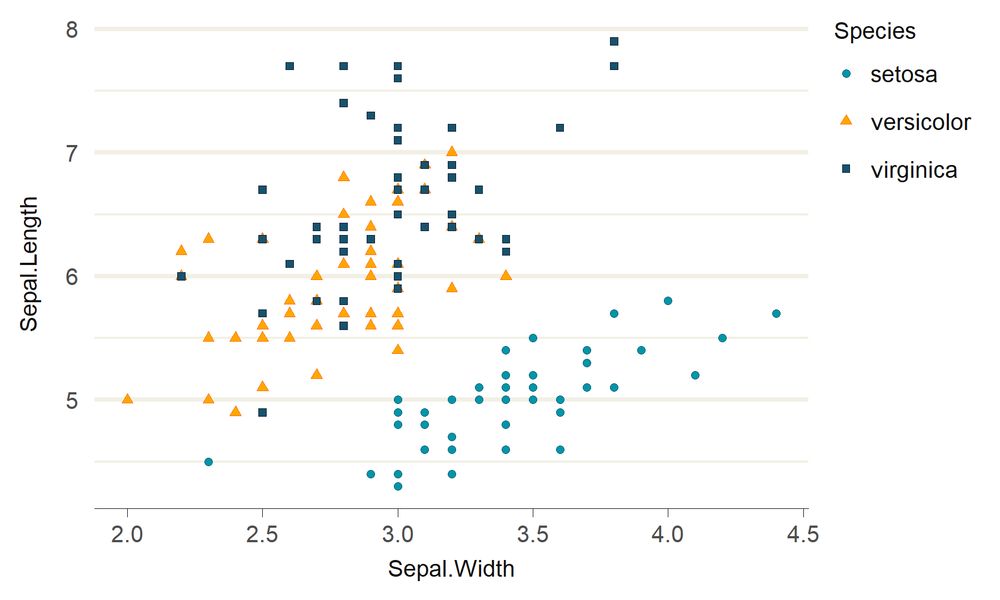
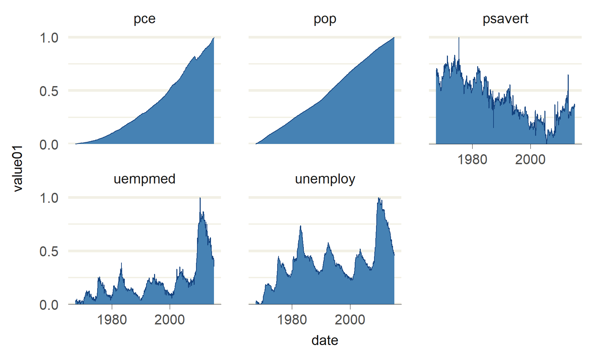

# ggblanket

## Objective

ggblanket is a package of ggplot2 wrapper functions for
publication-quality visualisation. It seeks to support well-designed
visualisation, while aligning as much as possible with ggplot2 and
tidyverse conventions.

## Installation

Install from CRAN, or development version from
[GitHub](https://github.com/).

``` r

install.packages("ggblanket") 
pak::pak("davidhodge931/ggblanket")
```

## Example

``` r

library(ggblanket)
library(ggplot2)
library(dplyr)

iris |>
  gg_point(
    x = Sepal.Width,
    y = Sepal.Length,
    fill = Species,
    shape = Species,
  )
```



``` r

ggplot2::economics_long |>
  gg_area(
    x = date,
    y = value01,
    facet = variable,
  )
```



## How it works

Use the `gg_*()` wrapper functions to:

- Plot a ggplot and geom layer in a single function
- Map aesthetic and facet variables as bare names
- Get `colour` and `colour_*` arguments inherited from `fill` and
  `fill_*` arguments
- Change scale arguments easily with prefixed arguments
- If lower x/y scale limit is zero, get default scale expansion of
  `ggplot2::expansion(c(0, 0.5))`
- Access to other arguments within relevant `geom_*` function via `...`
- Plus more!

## Other packages

This package is part of a group of related packages built to extend
[ggplot2](https://ggplot2.tidyverse.org).

|  |  |  |  |  |  |
|:--:|:--:|:--:|:--:|:--:|:--:|
| [](https://davidhodge931.github.io/ggblanket/) | [](https://davidhodge931.github.io/ggrefine/) | [](https://davidhodge931.github.io/ggscribe/) | [](https://davidhodge931.github.io/ggwidth/) | [](https://davidhodge931.github.io/blends/) | [](https://davidhodge931.github.io/jumble/) |
